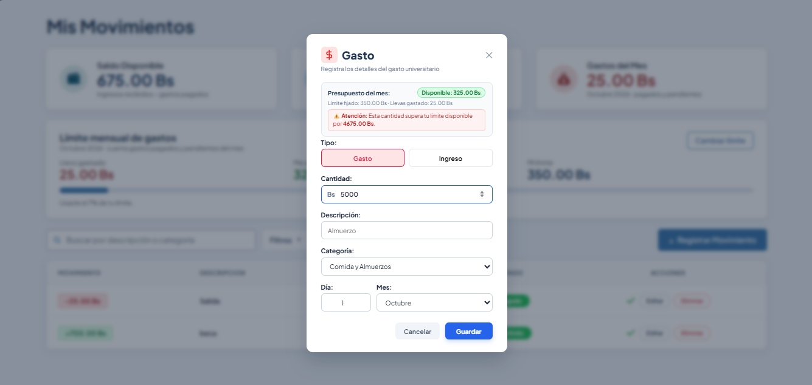
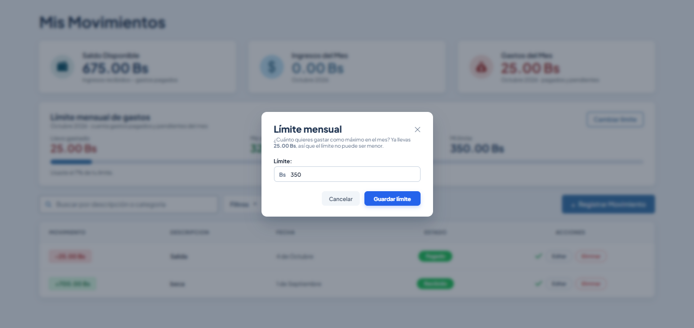
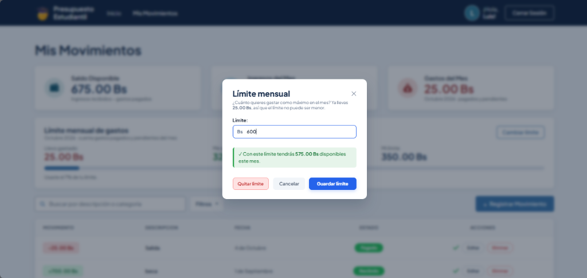
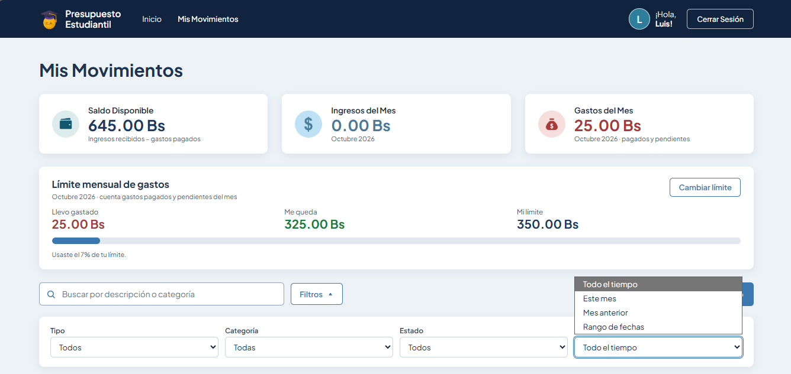
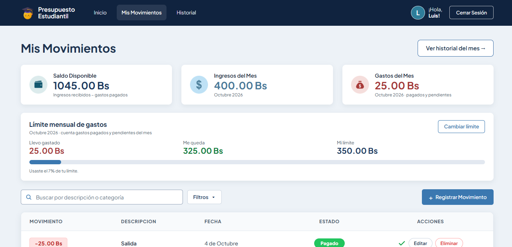
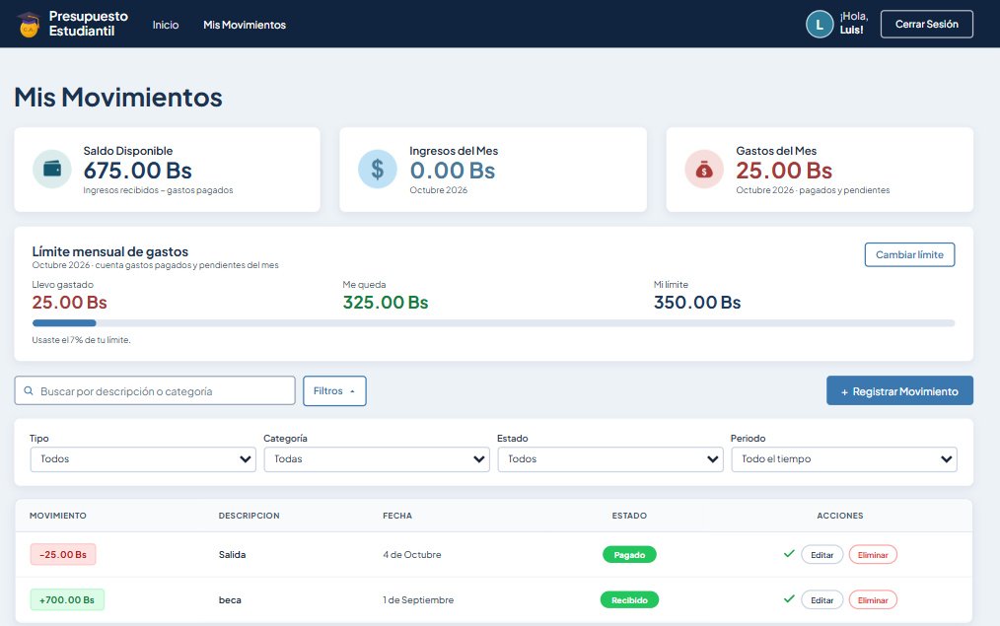
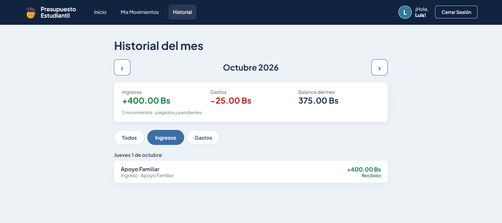
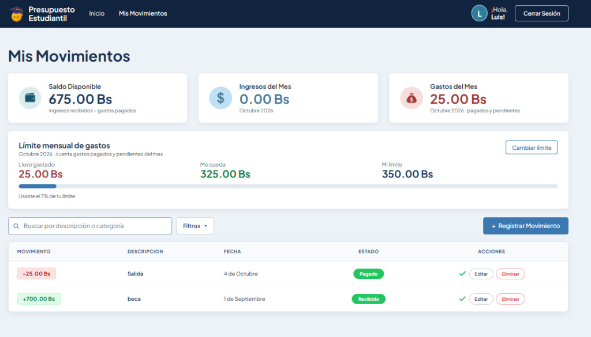
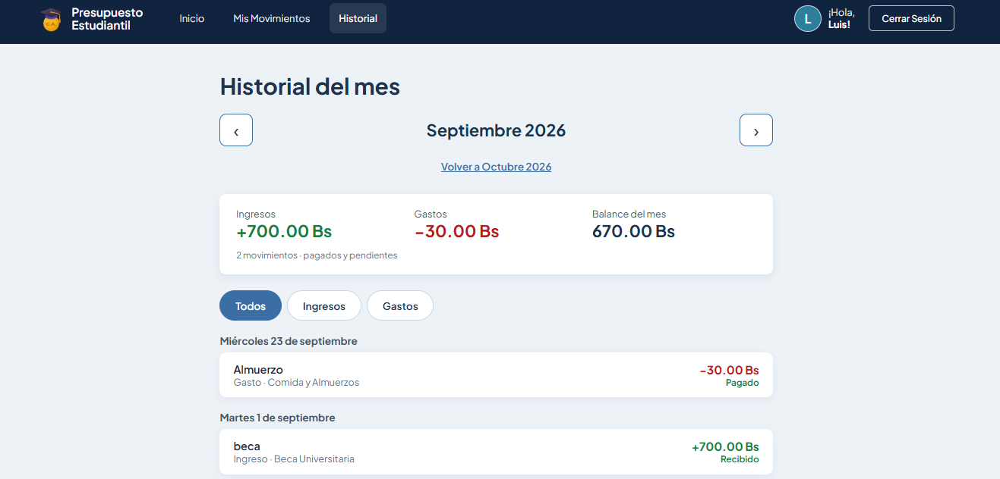
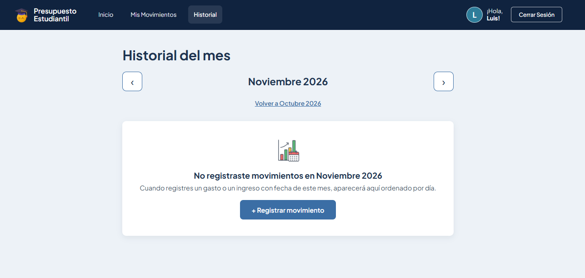

# Actividad Clase 16: Decisiones de Interacción
## Del hallazgo a la decisión (Fitts, Hick y Carga Cognitiva)

**Materia:** Interacción Humano-Computador (IHC) — Proyecto 2  
**Estudiante:** Carmen Jenifer Aranibar Fernandez  
**Aplicación:** Presupuesto Estudiantil  
**Tema Asignado (Lámina 17):** *Presupuesto: Registrar gasto · categorías · límite y disponible*  
**Objetivo:** Documentar un hallazgo por principio (Fitts, Hick y Carga Cognitiva), priorizar uno por su impacto en la tarea, implementar su corrección en el código y verificarlo en funcionamiento.

> *"No buscamos decorar. Buscamos reducir esfuerzo físico y mental durante una tarea concreta. Las heurísticas señalan el problema; hoy afinaremos la solución."*

---

## 1. Registro de los Tres Hallazgos (Láminas 16 y 18)

| # | Principio | Captura Obligatoria | Elemento y Problema Observado | Justificación Breve de Interacción | Estado al Terminar |
|---|---|---|---|---|:---:|
| **1** | **Ley de Fitts** *(Esfuerzo motor / Alcanzar)* | `docs/evidencias/clase-16/fitts-hallazgo.png`  | **Botón de cierre modal "✕" pequeño y distante:** En el modal de *Registrar Gasto*, el único control rápido para descartar la acción es un icono "✕" de apenas 24 px ubicado en la esquina superior derecha, a gran distancia del flujo visual y de los campos donde el estudiante interactúa. | **Tamaño y distancia:** El objetivo pequeño y alejado exige alta precisión motora y mayor tiempo de movimiento. No toda el área visible facilita el cierre seguro. | **Documentado.** |
| **2** | **Ley de Hick** *(Esfuerzo de selección / Elegir)* | `docs/evidencias/clase-16/hick-hallazgo.png`  | **Selector plano de categorías sin jerarquía ni prioridad:** Al desplegar el campo *Categoría*, se presentan 8 opciones simultáneas compitiendo al mismo nivel (`Comida y Almuerzos`, `Transporte y Pasajes`, `Fotocopias y Material`, `Internet y Saldo`, `Vivienda y Alquiler`, `Salud y Medicamentos`, `Ocio y Salidas`, `Otros Gastos`), sin destacar las más habituales de un universitario. | **Cantidad y prioridad:** Demasiadas alternativas compiten al mismo tiempo. No existe agrupación temática ni prioridad para los gastos cotidianos más frecuentes, aumentando el tiempo de decisión. | **Documentado.** |
| **3** | **Carga Cognitiva** *(Esfuerzo mental / Comprender)* | `docs/evidencias/clase-16/carga-cognitiva-hallazgo.png`  | **Ausencia de proyección del disponible al definir o modificar el límite:** En el modal *Límite mensual*, el estudiante ingresa una cifra (ej. `600 Bs`), pero el sistema únicamente le recuerda *"Ya llevas gastado X Bs"*. No muestra en tiempo real cuánto dinero le quedará disponible si aplica ese límite. Obliga al estudiante a realizar mentalmente una resta aritmética manual (`Nuevo Límite − Gastado = Disponible`). | **Memoria y cálculo innecesario:** La interfaz no proyecta el resultado de la decisión en el contexto en que se usa; obliga a gastar memoria de trabajo en una resta mental que el sistema debe calcular de inmediato. | **Documentado.** |

---

## 2. Priorización del Hallazgo (Lámina 16)

> **Consigna:** *No necesitan corregir los tres hoy. Deben documentar los tres, priorizar uno, terminar su corrección y comprobarla en la aplicación.*

### Hallazgo Seleccionado
👉 **Hallazgo #3: Carga Cognitiva — Proyección en tiempo real del saldo disponible resultante al definir o modificar el límite mensual.**

### Justificación de la Elección
1. **Alineación directa con el tema asignado:**  
   La funcionalidad asignada para nuestro grupo es explícitamente: ***«Registrar gasto · categorías · límite y disponible»***. El valor de fijar un presupuesto o límite radica en conocer con certeza cuánto dinero *disponible* le queda al estudiante para sobrevivir el mes. Si el modal obliga a calcular ese número con la mente, el sistema falla en su propósito principal.
2. **Eliminación de trabajo mental innecesario (Láminas 11 y 13):**  
   Tal como establece la diapositiva de Carga Cognitiva: *"La interfaz no debe gastar memoria en trabajo innecesario"*. Forzar al usuario a recordar cuánto lleva gastado y restarlo manualmente del número que tipea sobrecarga la memoria de trabajo. El sistema debe mostrar el dato visible y contextualizado en tiempo real.
3. **Impacto real en la toma de decisiones financieras:**  
   Al ver instantáneamente el impacto del nuevo límite (*«✓ Con este límite tendrás X.XX Bs disponibles este mes»* o *«⚠️ Este límite no te deja saldo disponible»*), el estudiante ajusta su presupuesto de forma informada sin ensayo y error.

---

## 3. Corrección Implementada (Commit 2)

### 3.1 Solución en Código Frontend (`MovimientosView.vue`)
Se implementó una propiedad computada reactiva y un bloque visual de retroalimentación en el modal de límite:

1. **Lógica computada reactiva (`nuevoDisponibleEstimado`):**
   Evalúa en tiempo real el valor ingresado en `limiteEscrito` comparándolo contra `limiteInfo.gastado_mes`:
   - Si el límite escrito es mayor a lo gastado: calcula la diferencia exacta (`nuevo_limite - gastado_mes`).
   - Si el límite escrito es menor o igual a lo gastado: identifica el estado de alerta preventiva sin saldo disponible.

2. **Caja visual de proyección contextual en el modal:**
   Justo debajo del campo de entrada de dinero, se despliega una tarjeta de confirmación en tiempo real:
   - **Verde / Informativo:** `✓ Con este límite tendrás X.XX Bs disponibles este mes.`
   - **Ámbar / Alerta:** `⚠️ Atención: Con este límite no tendrás disponible (ya llevas gastado X.XX Bs).`

### 3.2 Evidencia del Después (Corrección Obligatoria)
- **Captura:** `docs/evidencias/clase-16/carga-cognitiva-despues.png`  
  
- **Resultado:** El usuario tipea el monto deseado y ve inmediatamente cuánto saldo disponible tendrá sin hacer ningún cálculo mental.

---

## 4. Trazabilidad de Commits (Lámina 18)

1. **Commit 1:**  
   `docs: registrar hallazgos de interacción`  
   *Registra la documentación completa de los tres hallazgos (Fitts, Hick y Carga Cognitiva) y la priorización.*

2. **Commit 2:**  
   `fix: aplicar mejora de interacción`  
   *Aplica la lógica reactiva en `MovimientosView.vue` y añade la captura del después en `docs/evidencias/clase-16/carga-cognitiva-despues.png`.*

---
---

---
---

---
---

---
---

# Tarea 4: Historial del mes — Decisiones de interacción

**Issue principal:** #12 — *Historial del mes: ¿Qué movimientos tuvo el mes?*
**Pregunta que responde:** ¿Qué movimientos tuvo el mes?

> *"El historial convierte acciones aisladas en una trayectoria visible."* La pantalla nueva `/historial` muestra, por cada movimiento, **qué ocurrió** (descripción y tipo), **cuándo** (agrupado por día), **cuál fue el resultado** (monto con signo y estado con texto) y **qué elemento estuvo involucrado** (categoría).

## Cómo funciona (de los datos a la pantalla)

| Capa | Qué hace | Código |
|---|---|---|
| Datos | Usa los movimientos guardados en la tabla `movimientos` (no datos de ejemplo). Valida el mes, agrupa por día y calcula ingresos, gastos y balance. | `PRESUPUESTO ESTUDIANTIL/BACKEND/historial_mes.py` (`mes_desde_texto` L21, `consultar_historial` L32, `agrupar_por_dia` L38, `resumen_del_mes` L48) |
| Consulta | `GET /movimientos/historial?mes=AAAA-MM`, siempre filtrado por el usuario que inició sesión y del más reciente al más antiguo. | `PRESUPUESTO ESTUDIANTIL/BACKEND/routers/movimientos.py` L165 |
| Interfaz | Vista "Historial del mes". El mes queda en la URL (`?mes=2026-09`), así al recargar se ve el mismo mes. | `PRESUPUESTO ESTUDIANTIL/FRONTEND/src/views/HistorialView.vue` |
| Pruebas | 15 pruebas: mes correcto (día 1 y último día), orden, usuario correcto, resumen, mes vacío, mes inválido y "registrar → aparece en el historial". | `PRESUPUESTO ESTUDIANTIL/BACKEND/tests/test_historial_mes.py` |

---

## Decisión 1 · Ley de Fitts (alcanzar)

| | |
|---|---|
| **Antes** |  |
| **Hallazgo** | Para ver los movimientos del mes había que hacer **3 clics en objetivos pequeños**: botón "Filtros" → select "Periodo" → opción "Este mes". La lista desplegable tiene opciones de unos 20 px de alto, en la esquina derecha y lejos de la lista. |
| **Decisión** | El historial tiene una **entrada directa y grande**: enlace "Historial" siempre visible en la barra (toda el área de 44 px es clicable, no solo el texto) y botón "Ver historial del mes →" de 48 px junto al título de Mis Movimientos. El cambio de mes usa flechas ‹ › de **48 × 48 px pegadas al nombre del mes**, y "Volver a <mes actual>" aparece justo debajo cuando se navega a otro mes. |
| **Después** |  |
| **Código** | `FRONTEND/src/App.vue` L13-14 (enlace Historial) y estilo `.nav-item-white` · `FRONTEND/src/views/MovimientosView.vue` L7-8 (botón "Ver historial del mes") · `FRONTEND/src/views/HistorialView.vue` L8-18 (flechas de mes) y L228 (`.btn-mes` 48 px) |
| **Justificación** | *"El objetivo pequeño y distante exigía precisión. Aumentamos el área y acercamos la acción a los datos."* De 3 clics precisos se pasa a 1 clic en un objetivo grande. |

## Decisión 2 · Ley de Hick (elegir)

| | |
|---|---|
| **Antes** |  |
| **Hallazgo** | Al abrir "Filtros" aparecen **4 selects a la vez** (Tipo, Categoría, Estado, Periodo) con varias opciones cada uno, y el periodo por defecto es "Todo el tiempo". Para responder "¿qué movimientos tuvo el mes?" la persona debe comparar y decidir entre todos ellos. |
| **Decisión** | El historial **abre ya en el mes actual** (no hay que elegir periodo) y solo deja **3 opciones visibles**: `Todos · Ingresos · Gastos`. Categoría y estado no compiten como filtros: se leen en cada movimiento. Los filtros avanzados siguen disponibles en Mis Movimientos (agrupar no es eliminar capacidades). |
| **Después** |  |
| **Código** | `FRONTEND/src/views/HistorialView.vue` L54-65 (botones segmentados) y `OPCIONES_TIPO` / `diasVisibles` en el `<script>` |
| **Justificación** | De 4 decisiones simultáneas se pasa a 1 sola decisión con 3 alternativas, y la opción más frecuente (el mes actual, todos los movimientos) ya viene elegida. |

## Decisión 3 · Carga cognitiva (comprender)

| | |
|---|---|
| **Antes** |  |
| **Hallazgo** | La lista mezcla meses ("4 de Octubre" y "1 de Septiembre" juntos). Para saber qué pasó en el mes hay que leer cada fecha y recordar las tarjetas de arriba, que además no coinciden con lo que se ve (dice *Ingresos del Mes 0.00 Bs* mientras la lista muestra +700 Bs de septiembre). |
| **Decisión** | Cada mes se ve por separado y **los movimientos se agrupan por día** ("Lunes 19 de octubre"). El **resumen del mes** (Ingresos · Gastos · Balance) está junto a la lista y se calcula con los mismos movimientos que se ven. Cada movimiento muestra primero lo necesario: descripción, `Gasto · Categoría`, monto con signo (+ / −) y **estado con texto** (Pagado / Pendiente / Recibido), no solo con color. |
| **Después** |  |
| **Código** | `FRONTEND/src/views/HistorialView.vue` L23-43 (resumen del mes), L71-91 (agrupación por día) y `textoEstado` L148 · `BACKEND/historial_mes.py` `agrupar_por_dia` L38 y `resumen_del_mes` L48 |
| **Justificación** | La persona ya no tiene que recordar datos de otra parte de la pantalla ni filtrar fechas con la mente: la interfaz le muestra el mes, sus días y su balance en el mismo lugar. |

---

## Estado vacío orientador

Si el mes no tiene movimientos se muestra *"No registraste movimientos en <mes>"*, una explicación breve y el botón **"+ Registrar movimiento"**, que lleva a Mis Movimientos con el formulario ya abierto.

- **Captura:** 
- **Código:** `FRONTEND/src/views/HistorialView.vue` L46-51 y `irARegistrar()` · `FRONTEND/src/views/MovimientosView.vue` `onMounted` (abre el formulario con `?registrar=1`)
